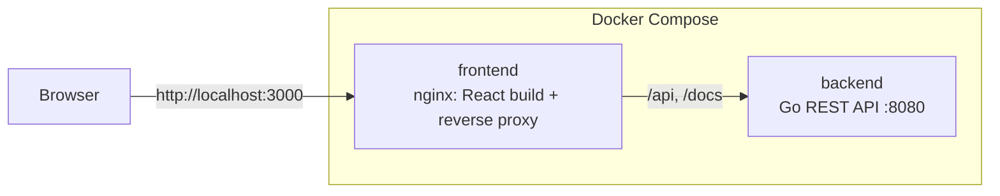

# Sezzle Calculator

[](https://github.com/yakumateo/sezzle-calculator/actions/workflows/ci.yml)

A full-stack calculator: a **React + TypeScript** frontend that consumes a **Go** REST microservice to
perform basic and advanced arithmetic operations.

- **Operations:** addition, subtraction, multiplication, division, power, square root and percentage.
- **Backend:** Go standard library only, Problem Details errors (RFC 9457), OpenAPI contract with Swagger UI.
- **Frontend:** React 19, strict TypeScript, accessible and responsive (mobile-first) single-page app.
- **Quality:** unit tests in both layers with coverage reports, CI on every push, Docker Compose for the full stack.

## Contents

- [Architecture](#architecture)
- [Project structure](#project-structure)
- [Quick start with Docker](#quick-start-with-docker)
- [Running the backend](#running-the-backend)
- [Running the frontend](#running-the-frontend)
- [AI usage](#ai-usage)

## Architecture



The browser only talks to nginx, which serves the React build and forwards `/api` and `/docs` to the Go
service. One origin means no CORS, and the backend publishes no port of its own. In development, the Vite
dev server plays the same role.

Inside each layer, dependencies point inwards:

| Backend (Go) | Frontend (React) | Responsibility |
|---|---|---|
| `internal/calculator` | `src/domain` | Pure logic: arithmetic rules / input format and display |
| `internal/httpapi` | `src/api` | HTTP: JSON, validation, status codes / fetch and error mapping |
| `cmd/server` | `src/hooks`, `src/components` | Wiring and presentation |

## Project structure

```
backend/
├── cmd/server/          entry point: HTTP server with graceful shutdown
├── internal/calculator/ domain: the seven operations and their errors
├── internal/httpapi/    HTTP layer: routes, request decoding, Problem Details
├── api/                 OpenAPI contract and Swagger UI page (embedded in the binary)
└── Dockerfile
frontend/
├── src/domain/          operation catalog, input validation, number formatting
├── src/api/             API client
├── src/hooks/           calculation state (idle, loading, success, error)
├── src/components/      calculator form and result panel
├── nginx.conf           static files + reverse proxy for the API
└── Dockerfile
docs/adrs.md             architecture decision records
docker-compose.yml       runs the full stack
```

## Quick start with Docker

Requires [Docker](https://docs.docker.com/get-docker/) with Docker Compose.

```bash
docker compose up --build
```

- App: <http://localhost:3000>
- API documentation (Swagger UI): <http://localhost:3000/docs>

Stop it with `docker compose down`.

## Running the backend

Requires **Go 1.27.2 or later** (1.27.0 and 1.27.1 have known `net/http` vulnerabilities).

```bash
cd backend
go run ./cmd/server
```

The API listens on <http://localhost:8080>; set `PORT` to change it. Swagger UI is at
<http://localhost:8080/docs> and the health check at <http://localhost:8080/health>. The server shuts down
gracefully on `Ctrl+C` or `SIGTERM`, letting in-flight requests finish.

## Running the frontend

Requires **Node.js 22 or later**. Start the backend first: the dev server proxies `/api` to `localhost:8080`.

```bash
cd frontend
npm ci
npm run dev
```

Open <http://localhost:5173>.

| Script | What it does |
|---|---|
| `npm run dev` | Dev server with hot reload and the API proxy |
| `npm run build` | Type-checks and builds the production bundle into `dist/` |
| `npm test` | Runs the unit tests once |
| `npm run coverage` | Runs the tests with a coverage report |
| `npm run lint` | Lints with oxlint |

## AI usage

This project was built with Claude Code as a pair programmer. The prompts that shaped it, and what I
decided at each step, are in [`PROMPTS.md`](PROMPTS.md).
