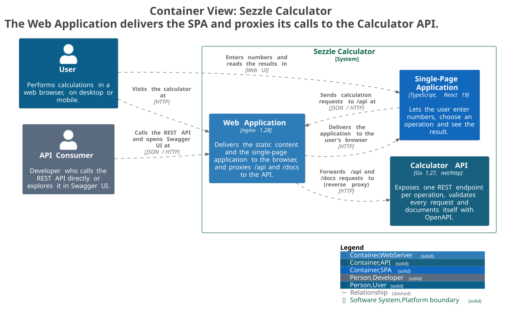

# Sezzle Calculator

[](https://github.com/yakumateo/sezzle-calculator/actions/workflows/ci.yml)

A full-stack calculator: a **React + TypeScript** frontend that consumes a **Go** REST microservice to
perform basic and advanced arithmetic operations.

- **Operations:** addition, subtraction, multiplication, division, power, square root and percentage.
- **Backend:** Go standard library only, Problem Details errors (RFC 9457), OpenAPI contract with Swagger UI.
- **Frontend:** React 19, strict TypeScript, accessible and responsive (mobile-first) single-page app.
- **Quality:** unit tests in both layers with coverage reports, CI on every push, Docker Compose for the full stack.

## Contents

- [Architecture](#architecture)
- [Project structure](#project-structure)
- [Quick start with Docker](#quick-start-with-docker)
- [Running the backend](#running-the-backend)
- [Running the frontend](#running-the-frontend)
- [API](#api)
- [Tests and coverage](#tests-and-coverage)
- [Design decisions](#design-decisions)
- [Assumptions and limitations](#assumptions-and-limitations)
- [AI usage](#ai-usage)

## Architecture



The browser only talks to nginx, which serves the React build and forwards `/api` and `/docs` to the Go
service. One origin means no CORS, and the backend publishes no port of its own. In development, the Vite
dev server plays the same role.

The full [C4 model](docs/c4/README.md) (landscape, context, containers, components of both applications and
the Docker Compose deployment) is written in Structurizr DSL.

Inside each layer, dependencies point inwards:

| Backend (Go) | Frontend (React) | Responsibility |
|---|---|---|
| `internal/calculator` | `src/domain` | Pure logic: arithmetic rules / input format and display |
| `internal/httpapi` | `src/api` | HTTP: JSON, validation, status codes / fetch and error mapping |
| `cmd/server` | `src/hooks`, `src/components` | Wiring and presentation |

## Project structure

```
backend/
├── cmd/server/          entry point: HTTP server with graceful shutdown
├── internal/calculator/ domain: the seven operations and their errors
├── internal/httpapi/    HTTP layer: routes, request decoding, Problem Details
├── api/                 OpenAPI contract and Swagger UI page (embedded in the binary)
└── Dockerfile
frontend/
├── src/domain/          operation catalog, input validation, number formatting
├── src/api/             API client
├── src/hooks/           calculation state (idle, loading, success, error)
├── src/components/      calculator form and result panel
├── nginx.conf           static files + reverse proxy for the API
└── Dockerfile
docs/adrs.md             architecture decision records
docs/c4/                 C4 model in Structurizr DSL, with PlantUML and SVG exports
docker-compose.yml       runs the full stack
```

## Quick start with Docker

Requires [Docker](https://docs.docker.com/get-docker/) with Docker Compose.

```bash
docker compose up --build
```

- App: <http://localhost:3000>
- API documentation (Swagger UI): <http://localhost:3000/docs>

Stop it with `docker compose down`.

## Running the backend

Requires **Go 1.27.2 or later** (1.27.0 and 1.27.1 have known `net/http` vulnerabilities).

```bash
cd backend
go run ./cmd/server
```

The API listens on <http://localhost:8080>; set `PORT` to change it. Swagger UI is at
<http://localhost:8080/docs> and the health check at <http://localhost:8080/health>. The server shuts down
gracefully on `Ctrl+C` or `SIGTERM`, letting in-flight requests finish.

## Running the frontend

Requires **Node.js 22 or later**. Start the backend first: the dev server proxies `/api` to `localhost:8080`.

```bash
cd frontend
npm ci
npm run dev
```

Open <http://localhost:5173>.

| Script | What it does |
|---|---|
| `npm run dev` | Dev server with hot reload and the API proxy |
| `npm run build` | Type-checks and builds the production bundle into `dist/` |
| `npm test` | Runs the unit tests once |
| `npm run coverage` | Runs the tests with a coverage report |
| `npm run lint` | Lints with oxlint |

## API

Every operation is a `POST` with a JSON body. The full contract is in
[`backend/api/openapi.yaml`](backend/api/openapi.yaml) and can be tried in Swagger UI at `/docs`.

| Endpoint | Body | Result |
|---|---|---|
| `POST /api/v1/add` | `{"a": 2, "b": 3}` | `a + b` |
| `POST /api/v1/subtract` | `{"a": 2, "b": 3}` | `a - b` |
| `POST /api/v1/multiply` | `{"a": 2, "b": 3}` | `a * b` |
| `POST /api/v1/divide` | `{"a": 10, "b": 4}` | `a / b` |
| `POST /api/v1/power` | `{"a": 2, "b": 10}` | `a` raised to `b` |
| `POST /api/v1/percentage` | `{"a": 15, "b": 200}` | `a` percent of `b` (here, 30) |
| `POST /api/v1/sqrt` | `{"a": 16}` | square root of `a` |
| `GET /health` | | `{"status": "ok"}` |

### Errors

Errors use Problem Details (`application/problem+json`):

| Status | When |
|---|---|
| `400` | Invalid JSON, a missing or unknown field, or a value that is not a number |
| `413` | The body is larger than 1 KiB |
| `422` | The request is valid but the result is undefined: division by zero, square root of a negative number, or a result out of range |

### Examples

The examples use port 3000 (Docker). When running the backend alone, use port 8080.

**Success**

```bash
curl -X POST http://localhost:3000/api/v1/divide -H "Content-Type: application/json" -d '{"a": 10, "b": 4}'
```

```json
{"operation":"divide","a":10,"b":4,"result":2.5}
```

**Division by zero (422)**

```bash
curl -X POST http://localhost:3000/api/v1/divide -H "Content-Type: application/json" -d '{"a": 1, "b": 0}'
```

```json
{"type":"about:blank","title":"Unprocessable Entity","status":422,"detail":"division by zero"}
```

**Missing field (400)**

```bash
curl -X POST http://localhost:3000/api/v1/add -H "Content-Type: application/json" -d '{"a": 1}'
```

```json
{"type":"about:blank","title":"Bad Request","status":400,"detail":"field \"b\" is required"}
```

**Square root (one operand)**

```bash
curl -X POST http://localhost:3000/api/v1/sqrt -H "Content-Type: application/json" -d '{"a": 16}'
```

```json
{"operation":"sqrt","a":16,"result":4}
```

**PowerShell.** PowerShell doesn't escape double quotes with `\"` like bash does. Wrap the JSON in single quotes
and call `curl.exe`, or use `Invoke-RestMethod`:

```powershell
curl.exe -X POST http://localhost:3000/api/v1/divide -H "Content-Type: application/json" -d '{"a": 10, "b": 4}'
Invoke-RestMethod -Method Post -Uri http://localhost:3000/api/v1/divide -ContentType "application/json" -Body '{"a": 10, "b": 4}'
```

## Tests and coverage

```bash
# Backend: unit tests and per-package coverage
cd backend
go test ./... -cover

# Backend: HTML coverage report (coverage.html)
go test ./... -coverprofile=coverage.out
go tool cover -html=coverage.out -o coverage.html

# Frontend: unit tests with coverage (text summary + HTML report in coverage/)
cd frontend
npm run coverage
```

Coverage at the time of writing:

| Layer | Package | Statements |
|---|---|---|
| Backend | `internal/calculator` (domain) | 100% |
| Backend | `internal/httpapi` (HTTP layer) | 99.1% |
| Backend | `api` (OpenAPI and Swagger UI) | 100% |
| Backend | `cmd/server` (entry point) | 0% |
| Frontend | all of `src/` (73 tests) | 100% statements, branches, functions and lines |

The backend total is 77.4% because `cmd/server` only wires the router into an `http.Server` and handles
shutdown signals. It has no logic of its own to unit-test; it is exercised by running the service, and
the Docker health check calls it on every run. The uncovered line in `httpapi` is a defensive fallback
for an unexpected JSON decoding error.

**What is tested:**

- **Backend:** table-driven tests for every operation and edge case (overflow, NaN, negative zero, division
  by zero), request decoding (invalid JSON, unknown fields, oversized bodies), and end-to-end HTTP tests
  through the router with `httptest`. A test fails if an endpoint is missing from the OpenAPI contract.
- **Frontend:** input validation and formatting, the API client with a mocked `fetch` (errors, timeouts,
  network failures), the state hook, each component with Testing Library, and an integration test of the
  whole page.

**CI:** [GitHub Actions](.github/workflows/ci.yml) runs formatting, vet, lint, tests with coverage, the
production build and the Docker image builds on every push. The HTML coverage reports are uploaded as
artifacts of each run.

## Design decisions

Each decision is explained, with its trade-offs and alternatives, in [`docs/adrs.md`](docs/adrs.md).

- **Go standard library only.** Since Go 1.22, `net/http` routes by method (`"POST /api/v1/add"`), so
  eight routes don't need a framework. The backend has no third-party dependencies.
- **Domain independent of HTTP.** `internal/calculator` is pure functions returning `(float64, error)`; the
  HTTP layer maps its sentinel errors to status codes. No persistence or application layer, since there is
  no data and each use case is one function call.
- **One endpoint per operation**, versioned under `/api/v1`, with one shared handler for all
  two-operand operations.
- **400 vs 422.** `400` means the request could not be understood; `422` means it was understood but the
  result is mathematically undefined.
- **float64 with guards.** Results that JSON cannot encode (`±Inf`, `NaN`) become errors, and `-0` is
  normalized to `0`.
- **Validation split.** The frontend checks that the input is a plain number; the math rules live only in
  the backend, so they cannot drift apart.
- **Reverse proxy instead of CORS.** Vite in development and nginx in Docker give the browser a single origin.
- **Hand-written OpenAPI contract** served by the backend with Swagger UI, guarded by a test.
- **No authentication.** There is nothing to protect; it would fit later as middleware or in the proxy.

## Assumptions and limitations

- **Percentage** means "`a` percent of `b`": `{"a": 15, "b": 200}` returns `30`.
- **Floating point.** Results are IEEE 754 `float64`, so `0.1 + 0.2` is `0.30000000000000004` in the API.
  The UI rounds non-integers to 15 significant digits for display (showing `0.3`) and shows integers in full.
  A financial ledger would use decimal arithmetic instead.
- **Number format.** The UI accepts plain decimals only (`1e3` is rejected because it is easy to type by
  mistake); the API accepts any valid JSON number, including `1e3`.
- **Request limits.** Bodies are limited to 1 KiB, and the UI aborts a request after 10 seconds.
- **`404` and `405`** for unknown routes or wrong methods are plain text, generated by Go's router, not
  Problem Details. The frontend never triggers them.
- **Same origin required.** The backend sends no CORS headers; the frontend must be served through the
  Vite dev server or nginx.
- **Swagger UI** loads its assets from a CDN, so `/docs` needs internet access.
- **Health check.** `/health` belongs to the backend: use port 8080 when running it alone. Through nginx
  (port 3000), only `/api` and `/docs` reach the backend.

## AI usage

This project was built with Claude Code as a pair programmer. The prompts that shaped it, and what I
decided at each step, are in [`PROMPTS.md`](PROMPTS.md).
