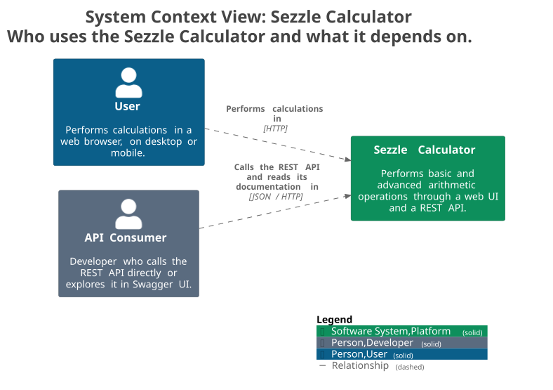
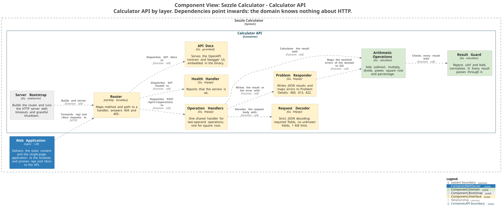
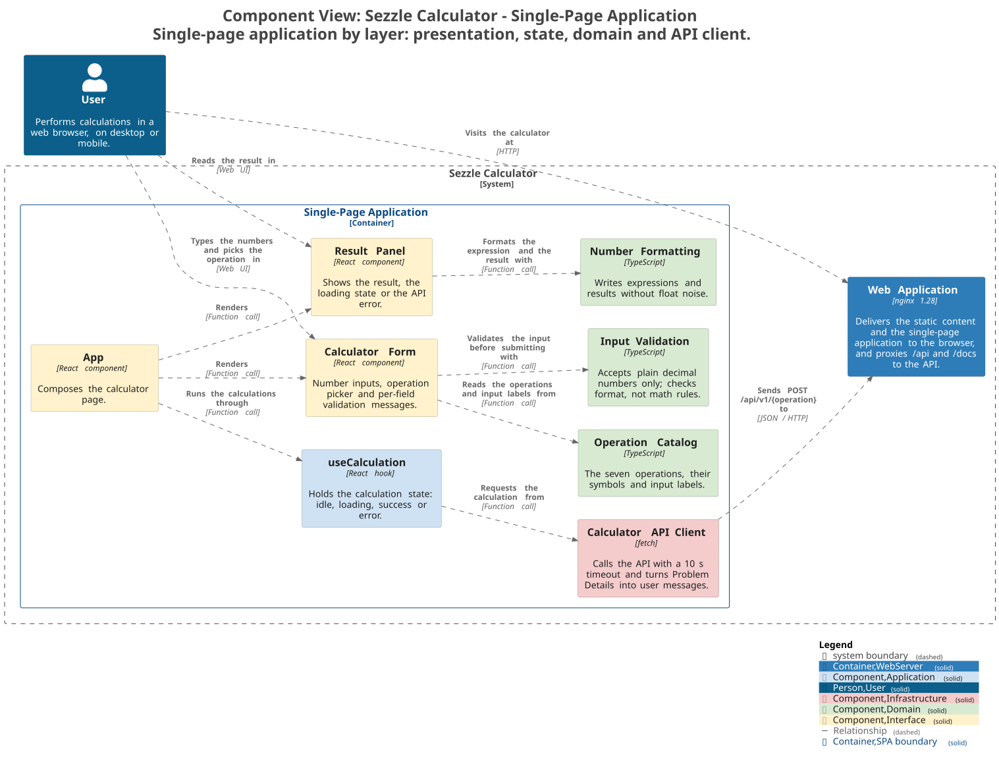
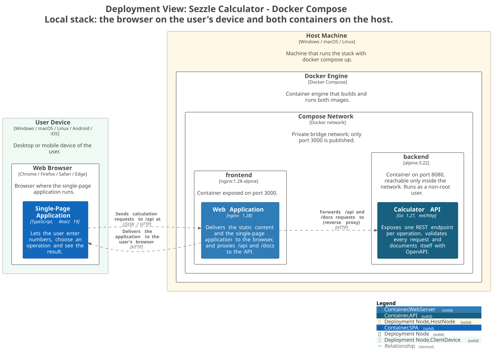

# C4 model

The architecture of the Sezzle Calculator, described with the [C4 model](https://c4model.com) in
[Structurizr DSL](https://docs.structurizr.com/dsl). The source of truth is [`workspace.dsl`](workspace.dsl);
the images below are generated from it.

## Views

| View | Level | What it shows |
|---|---|---|
| `SystemLandscape` | Landscape | People involved, the calculator and the external services it relies on |
| `SystemContext` | 1 · Context | Who uses the calculator and what it depends on |
| `Containers` | 2 · Container | The Web Application delivers the SPA and proxies its calls to the Calculator API |
| `Components-CalculatorApi` | 3 · Component | Inside the Go API, by layer |
| `Components-SPA` | 3 · Component | Inside the React application, by layer |
| `Deployment-DockerCompose` | Deployment | Where each container runs with `docker compose up` |

### System context



### Containers


The **Web Application** (nginx) is the server that delivers the **Single-Page Application** to the browser;
the SPA is the React code that then runs in the browser. Both are containers because they run in different
places. nginx also acts as reverse proxy, so the SPA calls `/api` on the same origin and nginx forwards it to
the **Calculator API**.

### Components: Calculator API



### Components: Single-Page Application



### Deployment: Docker Compose



## Notation

Components are colored by the layer they belong to, with the same convention in both containers:

| Tag | Layer | Examples |
|---|---|---|
| `Interface` | Entry points: HTTP handlers, React components | Router, Problem Responder, Calculator Form |
| `Application` | Coordination and state | useCalculation |
| `Domain` | Pure rules with no framework or I/O | Arithmetic Operations, Input Validation |
| `Infrastructure` | Adapters to the outside world | Calculator API Client |
| `Bootstrap` | Composition root | Server Bootstrap |

Dependencies point inwards: the domain never depends on HTTP or React. Relationships are declared explicitly
at each level (`!impliedRelationships false`).

## Files

| Path | Content |
|---|---|
| [`workspace.dsl`](workspace.dsl) | The model and its views (source of truth) |
| [`plantuml/`](plantuml) | The views exported to C4-PlantUML |
| [`images/`](images) | The views rendered to SVG |

## Rendering

- **Online:** paste `workspace.dsl` into the [Structurizr Playground](https://playground.structurizr.com).
- **Locally**, from `docs/c4`:

```bash
# Check that the model is valid
docker run --rm -v "$PWD:/usr/local/structurizr" structurizr/structurizr validate -workspace workspace.dsl

# Browse the diagrams interactively at http://localhost:8080
docker run --rm -p 8080:8080 -v "$PWD:/usr/local/structurizr" structurizr/structurizr local

# Regenerate plantuml/ and images/ after changing the model
docker run --rm -v "$PWD:/usr/local/structurizr" structurizr/structurizr export -w workspace.dsl -f plantuml/c4plantuml -o plantuml
docker run --rm -v "$PWD:/data" -w /data plantuml/plantuml:1.2024.7 -tsvg -o ../images plantuml/*.puml
```

Design decisions behind this architecture are recorded in [`../adrs.md`](../adrs.md).
